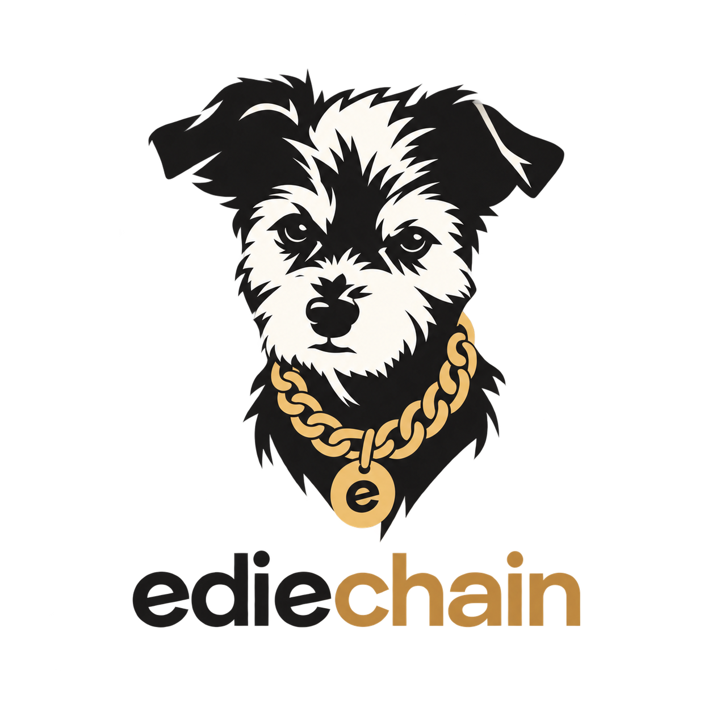

# Ediechain



A task graph for research pipelines. A task is a function. Calling it builds a node, not a
result. A node's key is the hash of its arguments, so an artifact is found by what produced it
and never by a run id.

## What it does

- **Tasks are functions.** `@task` on a plain function: the parameters are the inputs, the return
  annotation decides how the result is stored. No `Meta` class, no registry, no import side
  effects.
- **Keys, not run ids.** A key covers the task name, its `version=` and every argument, with a
  node argument replaced by its own key. Two experiments that share a prefix share its artifacts.
- **The runner pulls.** A node already in the store is loaded and nothing above it runs.
- **Per-parameter opt-outs.** `transparent` keeps a parameter out of the key while it holds its
  default; `ignore` keeps it out entirely, for a logger or a client.
- **`force` cascades.** A forced node keeps its key and changes its content, so everything below
  it is recomputed too.
- **Storage is a small table.** JSON for plain data, parquet for polars, npy for numpy,
  `store=IN_MEMORY` for a value that is never written, `store=PICKLE` as the escape hatch. A
  return type with no handler fails at import, not three hours into a run.
- **A node commits as one directory.** The artifact and its `run_info.json` are renamed into
  place together, so a reader never sees half a node and the second writer is refused.
- **Several processes, one store.** `@task(collective=True)` marks a body that every rank runs;
  everything else runs on one rank while the others wait and load.
- **Python configs.** An experiment is a module that composes tasks. No YAML — the definition of
  a run is type checked like any other code.

## Install

```bash
uv add ediechain                 # core; msgspec is the only dependency
uv add "ediechain[backends]"     # + numpy and polars handlers
uv add "ediechain[accelerate]"   # + several ranks, one store
uv add "ediechain[all]"          # everything
```

Python 3.13 or newer.

## Start here

- `examples/simple.py` — the whole API in one file. Run it twice; the second run computes nothing.
- `examples/demo/` — a repository laid out the way one is meant to be: domain code in `src/`,
  `@task` wrappers written once, experiments in `configs/`, a marimo notebook on top.
- `docs/ediechain_vs_taskchain.md` — coming from taskchain. A presenterm deck.
- `docs/glossary.md` — every term used in `src/`.

## Development

```bash
make             # ruff, ty, pytest — what a pipeline would run
make install     # environment with every extra
make build       # wheel and sdist into dist/
make publish     # to seznam-pypi-staging; needs SASANKA_TOKEN
```
